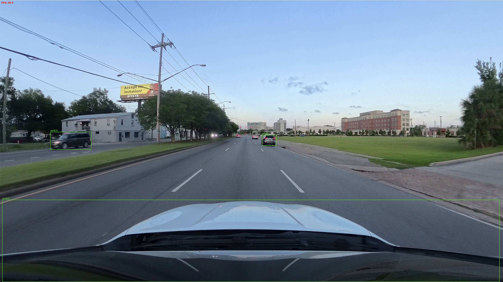
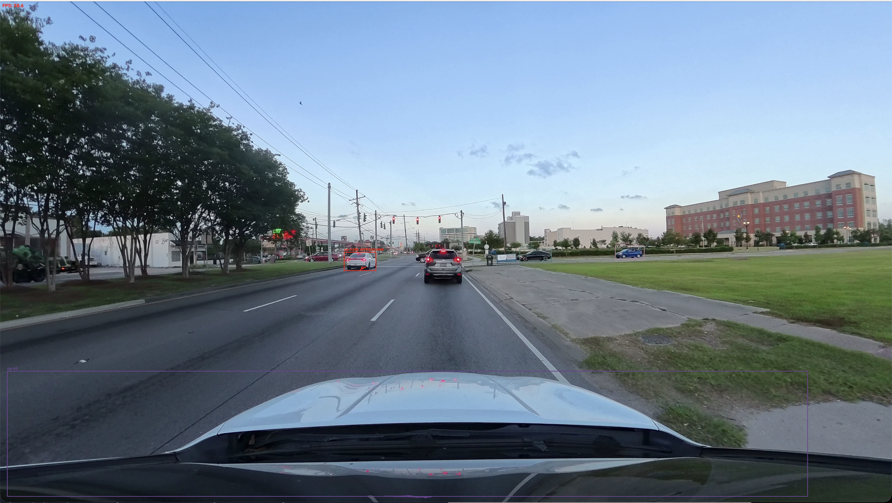
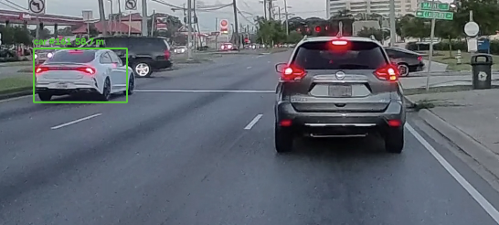
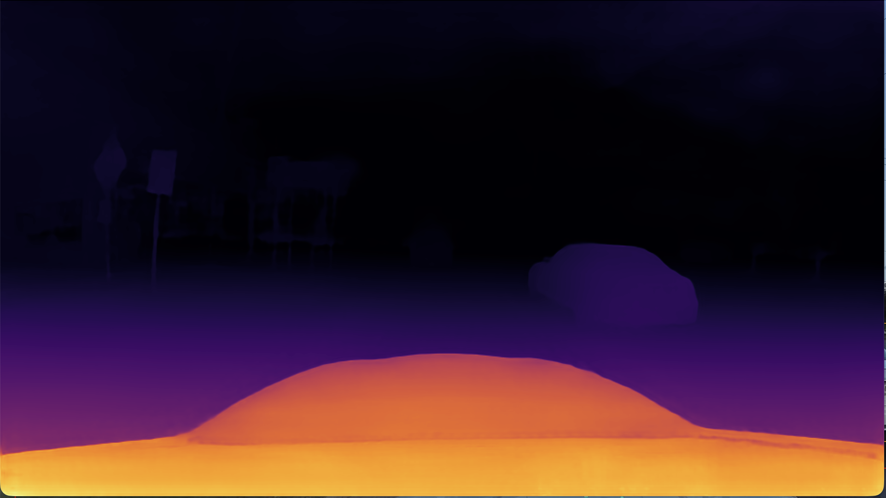
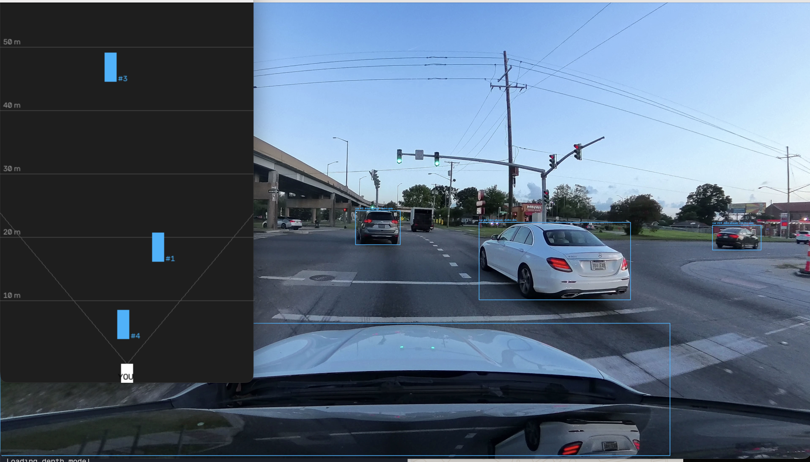
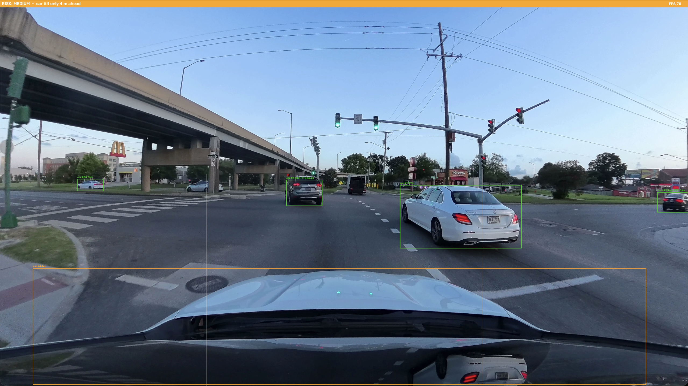
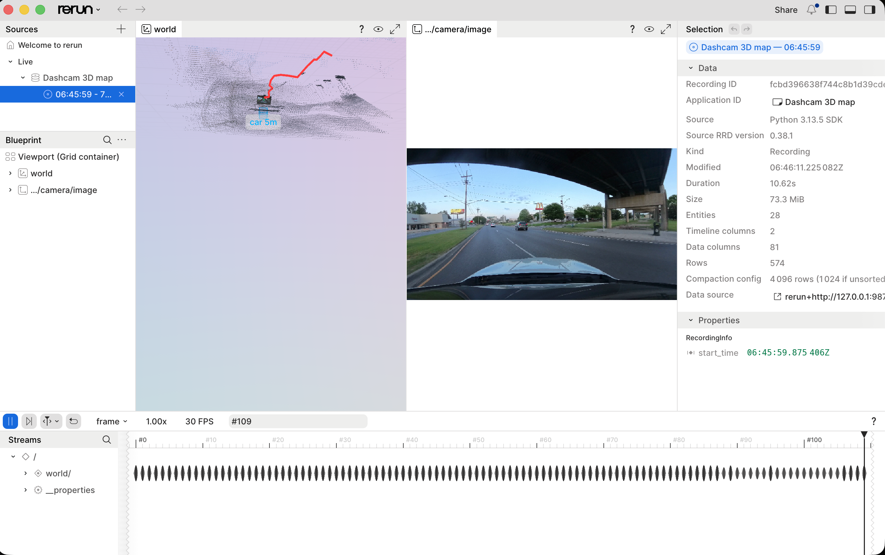
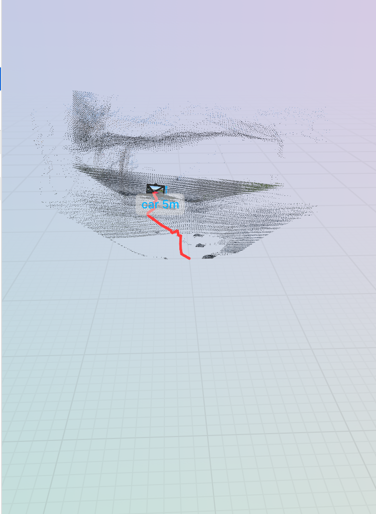

# Dashcam 3D Perception and Collision Risk System

## The steps explained

### Step 1 - Find objects (`step1_detect.py`)

A video is just lots of photos shown very fast (about 30 every second). This file looks at each photo and asks an AI called **YOLO**: "What's in this picture?"

YOLO draws a box around every car, person, bike, bus and truck it finds, with a number showing how sure it is. For example, `car 0.91` means "I'm 91% sure this is a car."

**Setting you can change:**

```python
CONFIDENCE = 0.4
```

A lower number like `0.1` shows lots of boxes, even wrong ones. A higher number like `0.8` only shows the boxes the AI is really sure about.

**Result:**



It found the cars on the road and ran at about 39 FPS on my Mac. One funny mistake: it also put a box around the bonnet (hood) of my own car at the bottom of the picture and called it a car. That's because YOLO has no idea which car is "mine". It just sees a car-shaped thing.

---

### Step 3 - Track objects (`step3_track.py`)

In Step 1, the AI forgets everything between photos. It can say "there's a car" but not "this is the **same** car as before".

A **tracker** fixes this. It gives each object a name tag like `car #7` and keeps it while the car stays on screen. It also draws a little trail behind each object, like a snail.

If a car's box gets bigger quickly, the car is getting closer, so its box turns red and says `APPROACHING`.

**Settings you can change:**

- `GROWTH_WARNING = 1.15` - how much a box must grow before it says `APPROACHING`. `1.05` warns a lot, `1.30` only warns when something is very close.
- `tracker="bytetrack.yaml"` - you can swap this for `"botsort.yaml"` to use a different tracker.

**What I found:** I tested both trackers on my video.

| | ByteTrack | BoT-SORT |
|---|---|---|
| Speed on my Mac | 30-60 FPS | 20-30 FPS |
| Did IDs get mixed up? | No | Yes |
| Kept IDs during turns? | Yes | No |

ByteTrack was faster and more stable, so I used it for every step after this.

**Result:**



Every object now has its own colour and ID number. The white car ahead in the left lane is red and marked `APPROACHING`, because its box was growing quickly as we caught up with it. My own bonnet still gets picked up as `car #4` at the bottom, the same mistake as in Step 1.

---

### Step 4 - Guess the distance (`step4_depth.py`)

A single camera can't measure distance. But close one eye and you can still guess how far things are, because far things look smaller and sit higher up in the picture.

A second AI called **Depth Anything** learned these clues. It guesses the distance in metres for **every pixel** of the picture. This is called a **depth map**. You'll see it in a second window: bright means near, dark means far.

The boxes now show distances, like `car #7 12.3 m`, and are coloured like traffic lights: red is near, orange is medium, green is far.

**Settings you can change:**

- `DEPTH_EVERY = 3` - the depth AI is slow, so it only runs every 3 photos. `1` is slower but always fresh, `10` is faster but laggy.
- `NEAR_M` and `MID_M` - choose when a box turns red or orange.
- `SHRINK = 0.3` - only measures the middle of each box, because the edges include bits of road behind the car. Keep this below `0.5`, or nothing is left to measure and all the boxes disappear.

**Result:**



Each box now shows a distance in metres. This car is green, which means the AI thinks it is more than 20 metres away.



This is what the depth AI "sees". Bright yellow and orange means near, dark purple means far. The road fades from bright to dark as it goes into the distance, and the car on the right shows up as its own shape. The brightest part at the bottom is my own bonnet, because it's the closest thing to the camera.

---

### Step 5 - Bird's-eye map (`step5_birdseye.py`)

Now we know where each car is **in the picture** and **how far away** it is. Put them together and we can work out where it is **on the road**:

- how far **ahead** of us (in metres)
- how far to the **left or right** of us (in metres)

The second window shows a map from above. Your car is the white box at the bottom marked `YOU`. Every object is a coloured rectangle at its real position, with a line every 10 metres.

The maths behind it is one formula:

```
sideways = (position in picture - middle of picture) x distance / focal length
```

**Settings you can change:**

- `CAMERA_FOV_DEG = 80` - how wide the camera can see. A car parked at the kerb should land about 3-4 metres to the side, so adjust this until it does.
- `PIXELS_PER_M = 10` - zoom the map in and out.
- `MAX_RANGE_M = 50` - hide objects that are too far away, because far guesses are messy.

**Result:**



The map on the left shows the same cars as the video, matched by their numbers. `#3` is the grey car far ahead, `#1` is the white car in the next lane to the right, and the box just in front of `YOU` (`#4`) is actually my own bonnet again.

---

### Step 6 - Collision risk (`step6_collision_risk.py`)

Being close isn't always dangerous:

- A car 10 m ahead going at **your** speed is **safe**. The gap isn't changing.
- A **stopped** car 30 m ahead is **dangerous**. The gap is shrinking fast.

So this step measures **how fast the gap is shrinking** and uses one simple formula:

```
time to collision = distance / closing speed
```

For example, 12 m away and closing at 6 m per second means 12 / 6 = **2 seconds until impact**.

| Time to collision | Risk |
|---|---|
| Less than 2 seconds | HIGH (red) |
| Less than 4 seconds | MEDIUM (orange) |
| More than that | LOW (green) |

A coloured banner at the top shows the biggest danger, like `RISK: HIGH - car #7 in 1.6 s`. Two white lines show your lane, because a car in the next lane isn't a threat.

**Settings you can change:**

- `HIGH_TTC` and `MEDIUM_TTC` - when it should warn. Real cars often warn at about 2-3 seconds.
- `IN_PATH_WIDTH` - how wide your lane is.
- `SMOOTHING` - the distance guesses wobble a bit, and wobbles cause fake warnings. `1.0` means no smoothing (very jumpy), `0.1` is very smooth but slow to react.

**Result:**



The cars ahead are green because the gap to them isn't shrinking fast. The orange banner says `car #4 only 4 m ahead`, but car #4 is my own bonnet. This is a false alarm: the system thinks the front of my own car is another car right in front of me. It's a good example of how one small mistake early on (Step 1) carries all the way through to the warnings.

---

### Step 7 - The dashboard (`step7_dashboard.py`)

This is the finished system. Everything runs together in one window:

```
+--------------------------+-------------+
|  camera view             |  map from   |
|  (boxes coloured by risk)|  above      |
+--------------------------+-------------+
|  risk banner + numbers + risk timeline |
+----------------------------------------+
```

The timeline at the bottom shows the risk over the last 10 seconds, so you can spot patterns, like risk going up at every traffic light.

One upgrade: your lane is now measured in **real metres** (less than 1.8 m to your left or right), not just a strip of the picture. That's only possible because of the map from Step 5.

**Settings you can change:**

- `LANE_HALF_WIDTH = 1.8` - how far left or right still counts as your lane. `1.0` is strict, `3.0` includes the next lane.
- `SAVE_VIDEO = True` - records everything into `dashboard_output.mp4`.
- `TIMELINE_SECONDS = 10` - how many seconds of history the timeline shows.

---

### Advanced Step A7 - 3D map of the street (`stepA7_3d_mapping.py`)

Every step before this only looked at one moment: "car #7 is 12 m ahead of **me** right now". But where is "me"? My car keeps moving.

This step works out two things at the same time:

1. **Where is my camera?** It draws the path my car drove as a red line.
2. **What does the street look like?** It builds a 3D cloud of coloured dots: road, kerbs, buildings and trees.

Doing both together is called **SLAM** (Simultaneous Localisation And Mapping).

How it works:

1. It finds about 2000 small spots that are easy to recognise, like window corners and road markings.
2. It finds the same spots in the next photo.
3. Using the distances from the depth AI, it works out how the camera moved. It's like knowing where you are because you recognise the buildings around you.
4. It turns the pixels into 3D dots and adds them to the map.

It ignores cars and people while doing this, because they move by themselves and would confuse it.

You need one extra library for this step (already in `requirements.txt`). It opens a 3D viewer called **Rerun**. Drag to spin the view, scroll to zoom, and use the slider at the bottom to replay the drive. The Terminal also prints your speed in km/h, worked out from the video alone.

**Settings you can change:**

- `CAMERA_FOV_DEG` - a wrong value makes straight roads look curved in 3D.
- `POINT_STEP` - `3` makes a dense map, `10` a light one.
- `MASK_MOVING_OBJECTS` - when set to `False`, cars are added to the map too and leave "ghost" smears behind them.

**Honest limit:** this is a simple version of SLAM. Small errors add up, so the red path slowly drifts on long videos. Professional systems fix this with extra tricks.

**Result:**



The Rerun viewer shows the 3D map on the left and the camera picture on the right, with a timeline at the bottom to replay the drive.



A closer look at the map. The grey dots are the street rebuilt in 3D, including the bridge above the road. The red line is the path my car drove, and the small box labelled `car 5m` is a car the system spotted nearby. The path is a bit wobbly, which shows the small errors adding up.

---

## Changing the settings

Every file has a **SETTINGS** section near the top. Open the file in a code editor (I use [VS Code](https://code.visualstudio.com/)), change a number, save (`Cmd + S`) and run the file again. Change one thing at a time so you know what caused the difference.

---

## What's next

Ideas for improving this project:

- **Camera calibration** - measure the real camera numbers instead of guessing the field of view
- **Kalman filter** - better smoothing, so fewer false alarms
- **Lane detection** - find the real painted lane lines
- **Near-miss log** - save a short clip and a record every time the risk goes HIGH, then analyse which places and objects are the riskiest
- **Testing on the KITTI dataset** - compare my distances with real laser measurements to see how accurate the system is

---

## Built with

- [YOLOv8](https://github.com/ultralytics/ultralytics) - finding objects
- [ByteTrack](https://github.com/ifzhang/ByteTrack) - tracking objects
- [Depth Anything V2](https://github.com/DepthAnything/Depth-Anything-V2) - guessing distances
- [OpenCV](https://opencv.org/) - reading videos and drawing
- [Rerun](https://rerun.io/) - the 3D viewer
